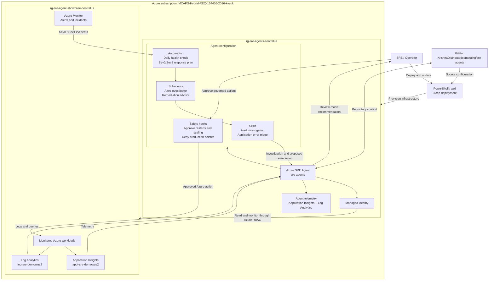

# Deploy the Azure SRE Agent

This repository deploys an Azure SRE Agent named `sre-agents` to the
`MCAPS-Hybrid-REQ-154436-2026-kvenk` subscription.

The checked-in configuration uses:

| Setting | Value |
|---------|-------|
| Azure region | `centralus` |
| Agent resource group | `rg-sre-agents-centralus` |
| Monitored resource group | `rg-sre-agent-showcase-centralus` |
| Access level | Low |
| Action mode | Review |
| Application Insights | `appi-sre-demowus2` |
| Log Analytics | `log-sre-demowus2` |

Review mode requires human approval before the agent performs operational
changes.

## Architecture



## 1. Install prerequisites

Install these tools on Windows:

* PowerShell 7 or later
* Azure CLI
* Azure Developer CLI
* Git
* `jq`

Run the repository prerequisite check:

```powershell
.\bin\ps\Install-Prerequisites.ps1 -CheckOnly
```

The deploying identity needs one of these role combinations:

* Owner
* Contributor and User Access Administrator

The role must apply to the agent resource group and every monitored scope.

## 2. Sign in

Authenticate with Azure and select the deployment subscription:

```powershell
az login
az account set --subscription fa4864b4-3710-453c-bffe-2c22a80cd0f9
azd auth login
```

Confirm the selected subscription:

```powershell
az account show --query "{name:name,id:id,user:user.name}" -o table
```

## 3. Review the agent configuration

Review these files before deployment:

* [`agents/sre-agents/agent.json`](../agents/sre-agents/agent.json)
* [`agents/sre-agents/connectors.json`](../agents/sre-agents/connectors.json)
* [`agents/sre-agents/config/`](../agents/sre-agents/config/)
* [`agents/sre-agents/automations/`](../agents/sre-agents/automations/)

Do not commit values added to
`agents/sre-agents/connectors.secrets.env`. The file is ignored by Git.

## 4. Validate the deployment

Assemble the configuration without calling Azure:

```powershell
.\bin\ps\Deploy-Agent.ps1 `
  -InputPath .\agents\sre-agents `
  -Subscription fa4864b4-3710-453c-bffe-2c22a80cd0f9 `
  -DryRun `
  -NoTelemetry
```

Run an Azure Resource Manager what-if operation:

```powershell
.\bin\ps\Deploy-Agent.ps1 `
  -InputPath .\agents\sre-agents `
  -Subscription fa4864b4-3710-453c-bffe-2c22a80cd0f9 `
  -WhatIf_ `
  -NoTelemetry
```

Review all planned role assignments before continuing.

## 5. Deploy

Deploy or update the agent:

```powershell
.\bin\ps\Deploy-Agent.ps1 `
  -InputPath .\agents\sre-agents `
  -Subscription fa4864b4-3710-453c-bffe-2c22a80cd0f9 `
  -NoTelemetry
```

The script deploys the Bicep resources and applies the skills, subagents,
hooks, prompts, incident filters, incident platform, and scheduled task.

If prompted for GitHub authorization, open the displayed URL, sign in to the
GitHub account that owns the repository, and approve the Azure SRE Agent app.

## 6. Verify

Run the repository verification script:

```powershell
.\bin\ps\Verify-Agent.ps1 `
  -Subscription fa4864b4-3710-453c-bffe-2c22a80cd0f9 `
  -ResourceGroup rg-sre-agents-centralus `
  -AgentName sre-agents `
  -Expected .\agents\sre-agents
```

Confirm the control-plane provisioning state:

```powershell
$url = "https://management.azure.com/subscriptions/" +
  "fa4864b4-3710-453c-bffe-2c22a80cd0f9/resourceGroups/" +
  "rg-sre-agents-centralus/providers/Microsoft.App/agents/" +
  "sre-agents?api-version=2025-05-01-preview"

az rest --method get --url $url `
  --query "{name:name,location:location,state:properties.provisioningState}" `
  -o table
```

Open [Azure SRE Agent](https://sre.azure.com/) and select `sre-agents` to test
an investigation.

## 7. Configure workload logs

Enable every supported log and metric category in the monitored resource group:

```powershell
.\scripts\Enable-DiagnosticSettings.ps1 `
  -Subscription fa4864b4-3710-453c-bffe-2c22a80cd0f9 `
  -ResourceGroup rg-sre-agent-showcase-centralus `
  -WorkspaceResourceId /subscriptions/fa4864b4-3710-453c-bffe-2c22a80cd0f9/resourceGroups/rg-sre-agent-showcase-centralus/providers/Microsoft.OperationalInsights/workspaces/log-sre-demowus2
```

The script discovers supported categories and creates an idempotent diagnostic
setting named `sre-agent-observability`. It configures Container Registry logs,
managed-environment console, system, and HTTP logs, Application Insights
telemetry, and supported platform metrics. It excludes the destination Log
Analytics workspace to prevent a logging loop.

> [!IMPORTANT]
> Enabling every supported category can increase Log Analytics ingestion and
> retention costs. Review workspace usage after deployment.

## 8. Publish updates

Push reviewed configuration changes to GitHub:

```powershell
git add .
git commit -m "feat(build): update SRE agent deployment"
git push origin main
```

Never commit access tokens, connector credentials, or generated secret files.

## 9. Remove the deployment

> [!CAUTION]
> This deletes the SRE Agent resource group and every resource created inside
> it. It does not delete the monitored resource group.

```powershell
az group delete `
  --name rg-sre-agents-centralus `
  --subscription fa4864b4-3710-453c-bffe-2c22a80cd0f9 `
  --yes
```

## References

* [Azure SRE Agent documentation](https://learn.microsoft.com/azure/sre-agent/)
* [Deploy Azure SRE Agent with infrastructure as code](https://learn.microsoft.com/azure/sre-agent/deploy-iac)
* [Official Microsoft templates](https://github.com/microsoft/sre-agent/tree/main/sreagent-templates)
